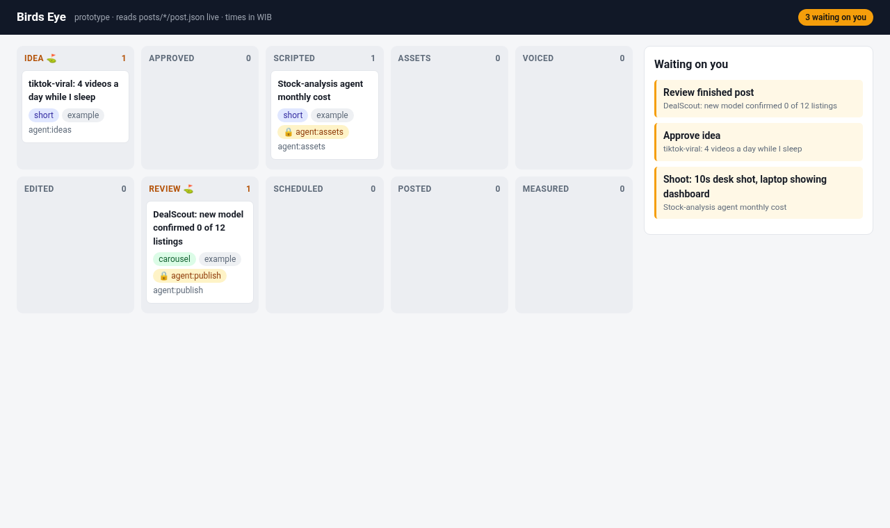
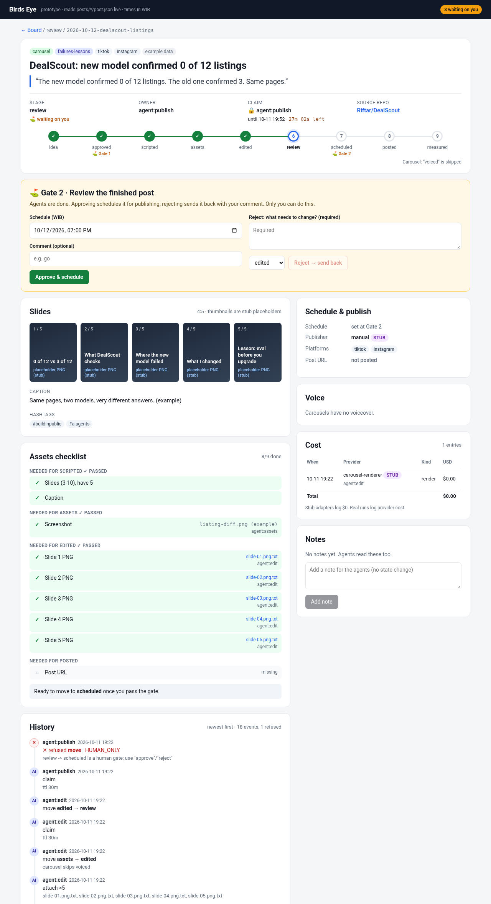
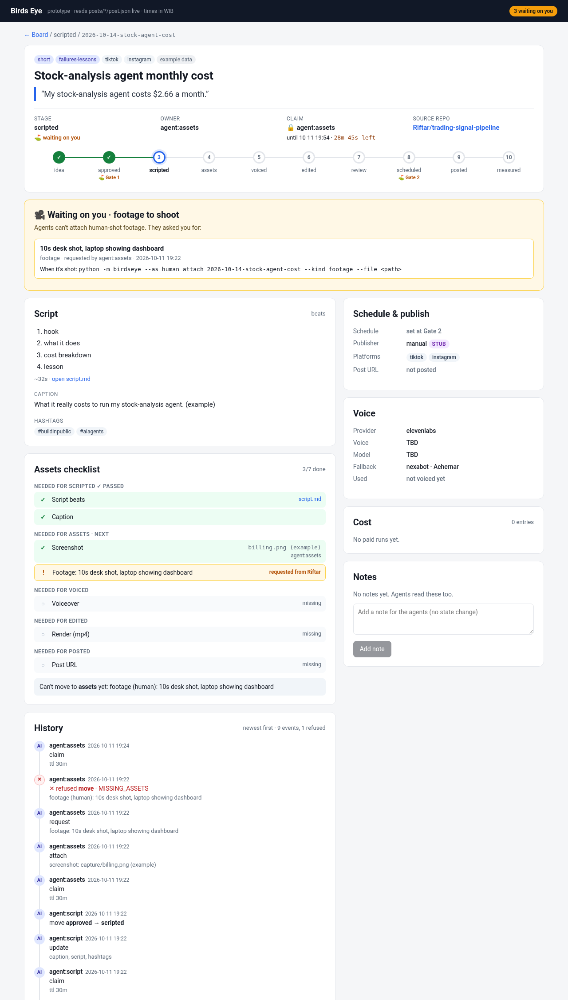
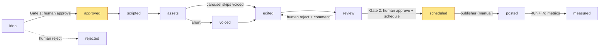

# Birds Eye (prototype)

Birds Eye is a personal content workflow plus dashboard for carousels and short videos about things I really build. Posts are files in git, one folder per post. Riftar and his AI agents work on the same files: agents do the work, and Riftar holds two gates.

> **This is a throwaway prototype** that shows the high-level flow. It uses only the Python 3 standard library, so nothing needs installing. The full spec is in [docs/spec.md](docs/spec.md), and the build plan for the real tool is in [NEXT.md](NEXT.md).

## Screenshots

**Board**: kanban by stage plus "Waiting on you". Click any card to open its detail page (`#/post/<id>`).



**Card detail, DealScout carousel at Gate 2 (review)**: stage stepper (voiced skipped), live claim countdown, Approve & schedule / Reject (comment required, choose the return stage), slide thumbnails, assets checklist, cost, and a history that includes the refused gate attempt.



**Card detail, stock-agent short at scripted**: the open "requested from Riftar" desk-footage item blocks `assets`, with the exact command to attach it once it's shot.



## Flow



- **Agents** (`--as agent:script`, `agent:edit`, and so on) claim a post and get a token. They pass that token on every write, and moving the post forward releases the claim.
- **Riftar** (`--as human`, which only works where `.birdseye/human.key` exists) approves or rejects at the two gates and supplies the human-shot footage.
- Every refused call writes nothing and returns a code: `HUMAN_ONLY`, `INVALID_TRANSITION`, `ALREADY_CLAIMED`, `CLAIM_LOST`, or `MISSING_ASSETS`.
- Every change appends one entry to the post's `history[]`. `STATUS.md` is regenerated after each command.

## Run it

```bash
python3 demo.py                      # walks a short + a carousel idea -> posted in .demo/ (seed posts untouched)
python3 -m unittest -v               # state machine, gates, claims
python3 -m birdseye serve            # dashboard at http://localhost:8787 (seeded example posts)
python3 -m birdseye.seed             # re-seed the 3 example posts (idempotent)
python3 mcp/tools.py                 # intended MCP tools -> CLI commands
```

CLI (all commands take `--as <actor>` and `--json`):

```
add · list [--blocked-on human] · show · claim · move <id> <stage> · update · attach [--request]
approve · reject --comment [--return-to] · comment --text · run voice|render|carousel · publish · status · serve · init-human
```

Example agent session:

```bash
python3 -m birdseye --as agent:script claim 2026-10-13-tiktok-viral-sleep      # -> token=c-xxxx
python3 -m birdseye --as agent:script move 2026-10-13-tiktok-viral-sleep approved --token c-xxxx
# REFUSED HUMAN_ONLY: idea -> approved is a human gate
python3 -m birdseye --as human approve 2026-10-13-tiktok-viral-sleep
```

## Seeded example posts (example data)

| Post | Format | Stage | Waiting on you |
|---|---|---|---|
| DealScout: 0 of 12 vs 3 of 12 listings | carousel | review | Gate 2 |
| tiktok-viral: 4 videos a day while I sleep | short | idea | Gate 1 |
| Stock agent costs $2.66 a month | short | scripted | desk footage request |

## What's real and what's stubbed

| Piece | Prototype |
|---|---|
| Post store `posts/<yyyy-mm>/<id>/post.json`, atomic write, `O_EXCL` lock | real (minimal) |
| State machine, carousel skip, backward-with-note, required fields per stage | real (subset of spec section 4) |
| Gates 1 and 2, human-only reject, R4 footage rule | real, but the "human key" is only a file-exists check |
| Claims (TTL, token, expiry, release on move) | real |
| Activity log `logs/activity/*.jsonl`, including refused calls with their reason | real (committed so the seeded refused attempts show up; `logs/cost/` is gitignored) |
| Voice (ElevenLabs, then Nexabot fallback), HyperFrames render, carousel PNGs | **STUB**: writes placeholder `.txt` files and a `$0` cost entry labelled STUB |
| Publisher | **STUB** manual: writes `publish/<year>-w<N>.json` with a checklist |
| Dashboard | stdlib `http.server` plus one HTML page: a board, and a card detail page with gates, content, assets checklist, voice, schedule, cost, history (including refused attempts from `logs/activity`), and notes. Approve, reject, and comment act as human, with **no auth** (localhost only) |
| Dashboard API | `GET /api/posts`, `GET /api/post?id=` (detail bundle from `core.detail`), `POST /api/approve` / `api/reject` / `api/comment`, `GET /files/<path>` (read-only, only inside `posts/`) | real |
| MCP server | **STUB**: `mcp/tools.py` only lists the tool names |
| JSON Schema validation, calendar view, asset rules, cost caps, metrics, neatlogs | not built, see NEXT.md |
